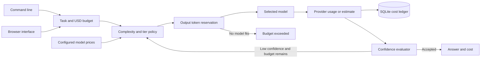

# Cost Aware Agent Router

## About

This app helps decide which model should handle a task when you have a spending limit. Give it a task, a budget, and a catalog of models with prices and capability tiers. It starts with a model that fits the task and budget, checks whether the answer meets your acceptance rule, and only moves to a stronger model when there is budget left. It records the decision so you can inspect cost over time.

### What you can do

- Set a per-task USD budget and a minimum model tier.
- Route a prompt through a price catalog you control.
- Stop early when an evaluator accepts the answer.
- Read a ledger of model choices, token usage, and estimated cost.

The CLI and local browser are usable with your own model provider and current price catalog. The included catalog is an example, not live pricing. Required-term checks are a simple acceptance rule, not proof that an answer is factually correct. The product has no public hosted URL yet, and it does not claim a measured percentage of savings.

## Quick start

Requires Python 3.11 or newer. From this repository:

```powershell
python -m venv .venv
.\.venv\Scripts\Activate.ps1
python -m pip install -e '.[dev]'
pytest -q
```

On macOS or Linux:

```bash
python3 -m venv .venv
source .venv/bin/activate
python -m pip install -e '.[dev]'
pytest -q
```

For live model calls, set `OPENAI_API_KEY` and optionally `OPENAI_MODEL` and `OPENAI_BASE_URL` as shown in `.env.example`. The test suite uses stubs and needs no model key.

The installed `cost-router` command accepts a JSON price catalog, task budget, complexity, and required output terms. Copy `examples/models.example.json`, replace model IDs and prices with your provider's current values, then run `cost-router --models models.json route "Write a summary including risks" --budget-usd 0.02 --complexity 2 --required-term risks`. Use `cost-router --models models.json analytics` to inspect the durable decision ledger. Run `cost-router --models models.json serve --port 8080` for a local browser interface. Required-term coverage is a deterministic acceptance check, not factual confidence; add an independent evaluator when quality matters.

```python
from cost_aware_agent_router.engine import CostRouter, Model
from cost_aware_agent_router.llm import OpenAICompatibleLLM

models = [Model("gpt-4.1-mini", 0.4, 1.6, 1), Model("gpt-4.1", 2.0, 8.0, 2)]
router = CostRouter(OpenAICompatibleLLM.from_env(), models, "cost.sqlite3")
result = router.route("task-123", "Summarize this short memo", budget_usd=0.02, complexity=1,
                      confidence_fn=lambda prompt, answer: 0.9 if answer.strip() else 0.0)
print(result, router.analytics())
```

## Architecture



| Component | Responsibility |
|---|---|
| Model catalog | Declares tiers, token prices, and output limits. |
| Router | Reserves budget and escalates only when confidence is low. |
| Ledger | Stores per-decision usage source, token counts, and cost. |

Task -> complexity floor -> model tier list -> reserve estimated tokens -> model call -> estimated cost ledger -> confidence gate -> early exit or escalation.

See [ARCHITECTURE.md](ARCHITECTURE.md) for components, state, failure behavior, and operations.

## Deployment and safety

See [DEPLOYMENT.md](DEPLOYMENT.md) for the non-root container, token-protected browser, data mounts, and release checks.

Pricing in this example is illustrative and must be updated from your provider's current price sheet. Costs and tokens are estimates, and a provider response can exceed a reserve. The system does not promise a particular percentage saving.

The SQLite ledger migrates older decision tables by adding provider usage columns on startup; existing historical rows remain available for analytics.

Install this as a library in an authenticated application or worker. Supply the LLM adapter through dependency injection. Keep secrets in environment variables, never in source control.

## Verification

`pytest -q` runs deterministic tests. GitHub Actions runs the same suite on pushes and pull requests.

## Product guide

### Plan a routing decision

Start by copying `examples/models.example.json` and replacing its model IDs, prices, tiers, and output limits with values from your provider. Then give `route` a prompt, a USD budget, a complexity score from 0 to 10, and any required output terms. The router estimates a safe starting tier, reserves room for output, calls a model that fits, and asks your evaluator whether the answer is acceptable. It escalates only while the budget allows.

| Input | Why it matters |
|---|---|
| Model catalog | Determines available tiers, token prices, and output limits. |
| Task budget | Caps which attempts the router may start. |
| Complexity | Sets a floor for the starting model tier. |
| Acceptance evaluator | Decides whether to stop or try a stronger model. |

`analytics` reads the durable decision ledger. It shows which model was selected, token counts, how usage was measured or estimated, and the cost assigned to each decision. The CLI's required-term check is intentionally simple; the Python library lets an application supply a stronger evaluator.

### Understand the numbers

Prices in the example catalog are illustrative. Update them whenever provider prices change. A reserved budget is based on estimates; a provider can report different token usage after the call. The ledger helps explain decisions, but it is not a billing system and it does not establish a particular savings percentage. For a meaningful cost comparison, evaluate the same workload against a fixed-model baseline and compare both quality and provider invoices.

### Configuration and operations

Set `OPENAI_API_KEY` for model calls and, when needed, `OPENAI_BASE_URL` and `OPENAI_MODEL` for the provider. Keep the catalog, ledger file, and model key under operator control. Use `cost-router --models models.json route ...` for a task, `analytics` for review, or `serve --port 8080` for the local browser. Back up the SQLite ledger if historical analytics matter. The browser is an operator interface, with deployment and access notes in [DEPLOYMENT.md](DEPLOYMENT.md). The decision flow and accounting assumptions are documented in [ARCHITECTURE.md](ARCHITECTURE.md).

### Common issues

| Symptom | Check |
|---|---|
| No model fits the budget | Verify the catalog's token prices and output limits, then raise the budget or narrow the task. |
| An answer stops too early | Strengthen the acceptance evaluator; required-term coverage alone is weak. |
| Estimated costs differ from invoices | Compare provider-reported token usage and current prices; the reservation is an estimate. |
| Analytics are empty | Confirm that route decisions use the same SQLite ledger file as `analytics`. |

When adding a new model, test representative tasks at each complexity tier and compare quality as well as cost. A cheaper model is only a saving if it still meets the application's acceptance criteria.

## License

MIT. See [LICENSE](LICENSE).
